# Десктоп-раскадровка лендинга

Референс: **Global Talent (Atlas)** с motionsites.ai — скриншот и описание, которые вы прислали. Ascend и Nexa Talent пока не учтены: их материалов у меня нет.

**Что взято из референса:** скруглённое «окно» героя с белыми полями вокруг; навигация, где каждый пункт в своей стеклянной таблетке; стеклянная карточка поиска с циклом анимации; кнопка из двух частей (таблетка и круг со стрелкой); белый вводный блок с крупным заголовком и стопкой аватаров; бенто, где на каждой сцене лежит фрагмент живого интерфейса. Один шрифт (Geist), без цветных акцентов: эмоцию дают сцены. Все фоны из одной вселенной, меняется только свет.

**Что своё:** вместо найма — путь товара в AI-коммерции. Карточка поиска показывает, как AI-ассистент рекомендует товар клиента. Вселенная — шёлк в тёплом свете: золото в герое и форме, персик и роза в бенто.

**Как сделаны кадры:** скриншоты макета [`mockups/desktop.html`](../../mockups/desktop.html), 1440 px. Состояния анимации заморожены параметром `?t=` (время цикла) и `?b=` (прогресс бенто). Сцены пока нарисованы кодом как черновая замена видео (промпты для генерации ниже). Фото товаров и команды — подписанные слоты: положите файлы в `assets/`, и они встанут сами.

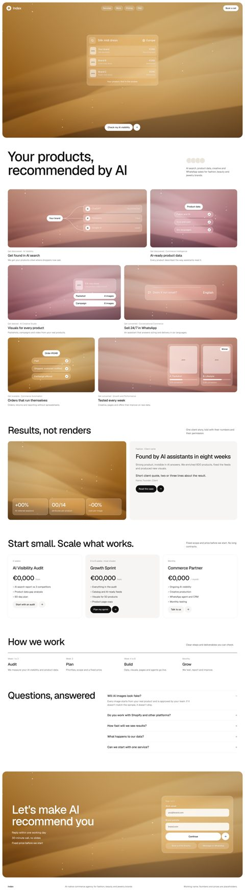

---

## Герой: цикл карточки поиска (9,5 с, бесконечно)

| Кадр | t | Что происходит |
|---|---|---|
| 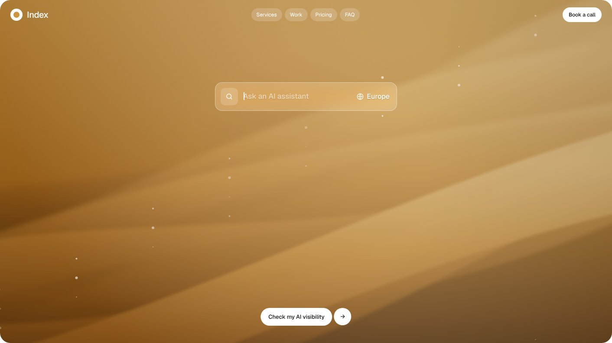 | 0,2 с | **01. Пусто.** Видна только шапка карточки: лупа, плейсхолдер «Ask an AI assistant», справа «Europe». Сцена: шёлк в золотом свете, пылинки в воздухе. Внизу кнопка «Check my AI visibility» + круг со стрелкой. |
| 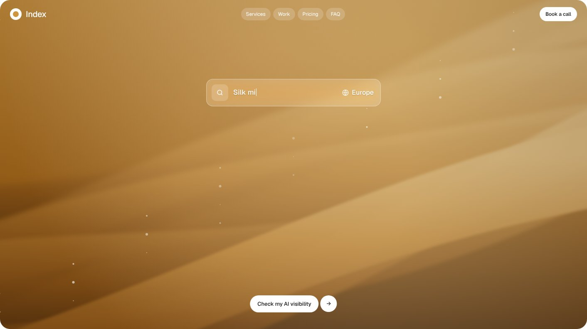 | 1,0 с | **02. Печать.** Запрос «Silk midi dress» печатается по 60 мс на символ, плейсхолдер исчезает. |
| 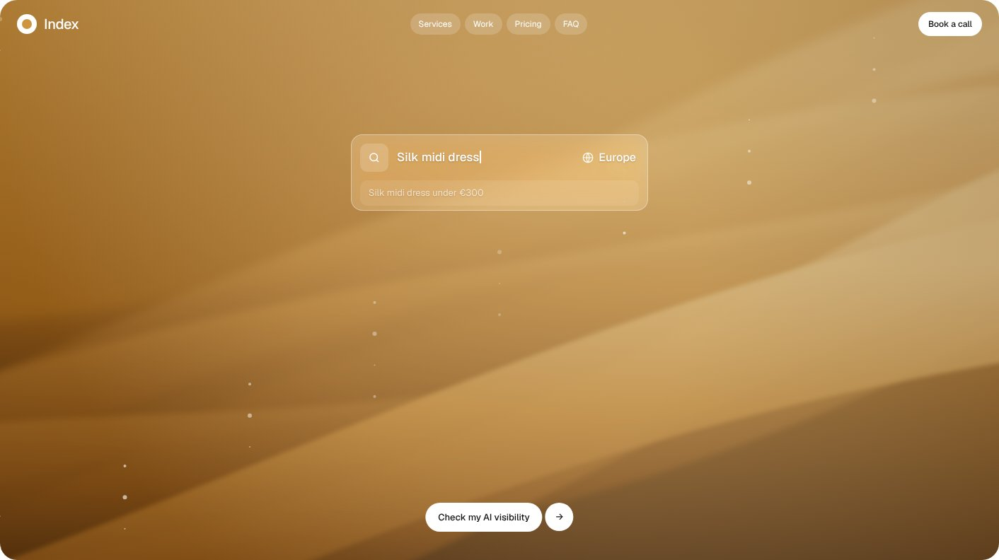 | 1,5 с | **03. Подсказка.** Строка «Silk midi dress under €300» появляется (fade, y 6→0) и через 0,5 с уходит. |
| 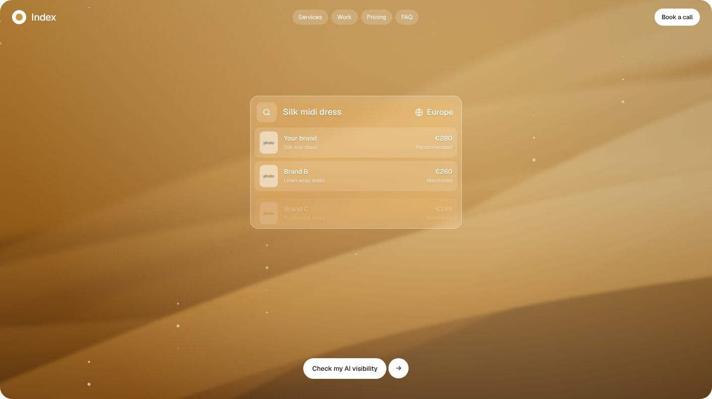 | 2,75 с | **04. Результаты.** Карточка растёт, строки выезжают по одной (y 12→0, 0,45 с, stagger 0,25 с, ease-out). Первая — товар клиента «Recommended», ниже конкуренты «Mentioned». |
| 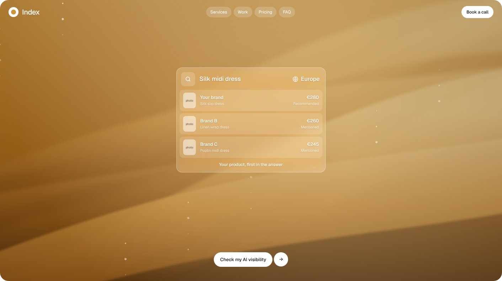 | 4,5 с | **05. Итог.** Футер «Your product, first in the answer». Держится до 7,5 с, затем строки уходят (stagger 0,08 с), запрос стирается, в 9,5 с цикл заново. |

**Смысл:** за 10 секунд показано главное обещание агентства. Покупатель спрашивает AI, и первым в ответе оказывается товар клиента.

## Вводный блок

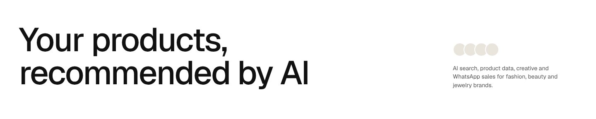

Слева H1 «Your products, recommended by AI» (Geist 500, около 80 px, межбуквенный −0,03 em). Справа стопка из четырёх аватаров команды и подзаголовок: «AI search, product data, creative and WhatsApp sales for fashion, beauty and jewelry brands.» Появление при скролле: заголовок fade + y 20→0, аватары по одному.

## Бенто: шесть услуг как живые сцены

Вместо списка услуг каждая услуга — карточка: сцена плюс фрагмент интерфейса, который показывает результат. Над названием подписан результат и практика. Ряды: 1,6fr + 1fr, затем 1fr + 1fr, затем 1fr + 1,6fr.

| Появление (35%) | Итог |
|---|---|
| 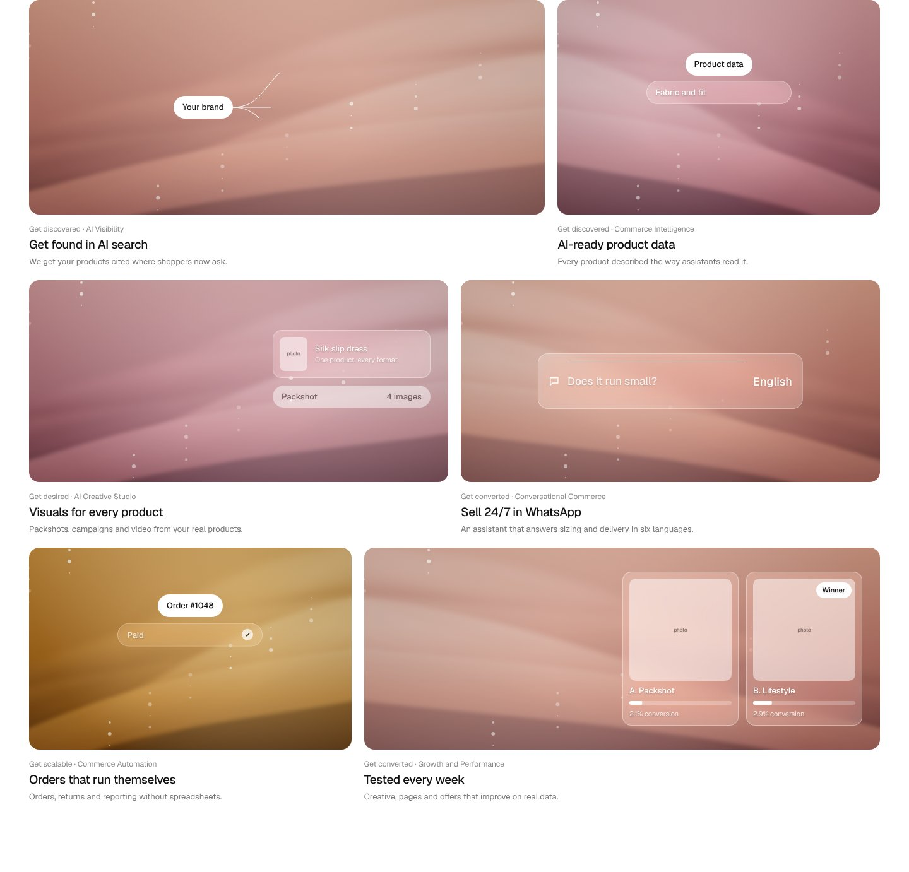 | 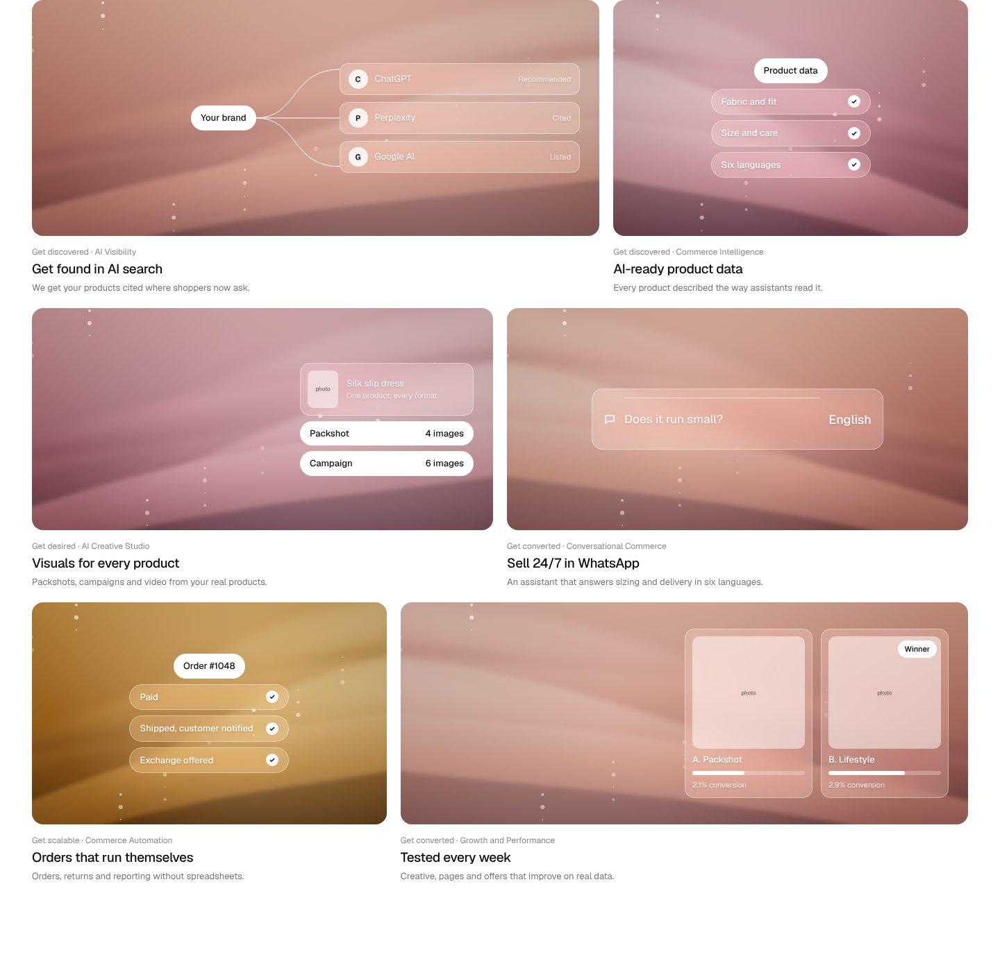 |

| Карточка | Фрагмент интерфейса и анимация |
|---|---|
| **Get found in AI search** (AI Visibility) | Белая таблетка «Your brand». От неё рисуются три линии (`stroke-dashoffset`) к стеклянным строкам ChatGPT «Recommended», Perplexity «Cited», Google AI «Listed», строки появляются по очереди. |
| **AI-ready product data** (Commerce Intelligence) | Таблетка «Product data» и три стеклянные строки: «Fabric and fit», «Size and care», «Six languages». Галочки «щёлкают» (scale 0→1). |
| **Visuals for every product** (AI Creative Studio) | Стеклянная карточка товара с вашим фото и две белые таблетки «Packshot, 4 images», «Campaign, 6 images». |
| **Sell 24/7 in WhatsApp** (Conversational Commerce) | Стеклянная строка сообщения «Does it run small?». Справа по кругу меняется язык: English → Deutsch → Français → Italiano → Español → Português. |
| **Orders that run themselves** (Commerce Automation) | Таблетка «Order #1048» и три шага с галочками: «Paid», «Shipped, customer notified», «Exchange offered». |
| **Tested every week** (Growth and Performance) | Два креатива A и B с полосками конверсии. Полоски растут, у B метка «Winner». |

Все оверлеи запускаются один раз, когда карточка входит в экран (`start: top 75%`). Фон карточки — лёгкий параллакс при скролле (yPercent −6…−8).

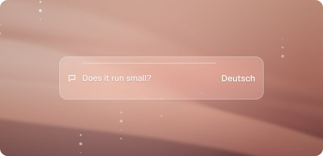

## Остальные секции (тот же тихий белый стиль)

| | |
|---|---|
| 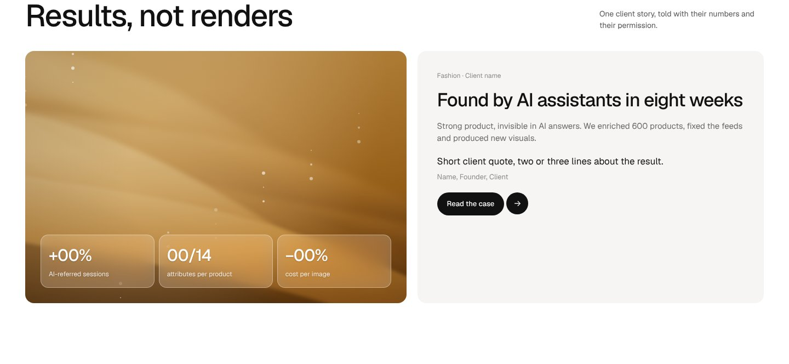 | **Кейс.** Слева сцена со стеклянными плитками цифр, справа история клиента, цитата и кнопка. Цифры — нули-плейсхолдеры. |
| 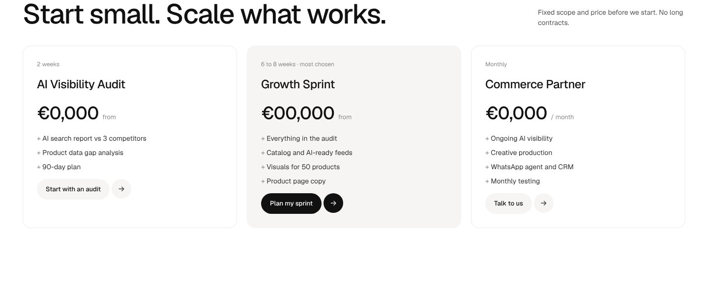 | **Пакеты.** Три тарифа, средний выделен тоном. Цены — плейсхолдеры. |
| 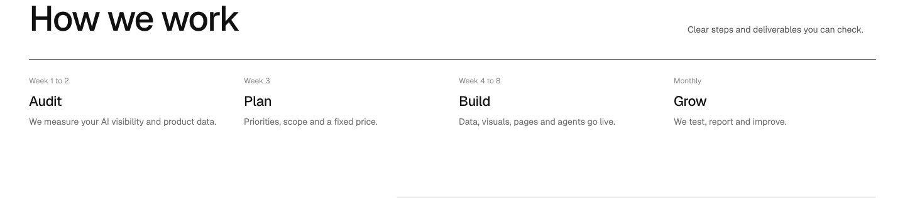 | **Процесс.** Четыре шага со сроками, одна линия сверху. |
| 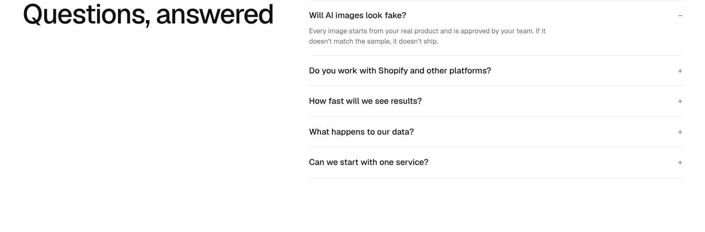 | **FAQ.** Аккордеон, первый вопрос открыт. |
|  | **Контакт.** Второе скруглённое окно в золотом свете (рифма с героем) и стеклянная форма в два шага: email и сайт, кнопка из двух частей, альтернативы — календарь и WhatsApp. |

---

## Сцены: промпты для генерации видео

Код рисует черновую замену. Для финала сгенерировать видео в одной стилистике (image → video, 5–8 с, бесшовный цикл):

- **Герой и контакт (золото):** «Flowing silk fabric in warm golden-hour light, honey and amber tones, soft folds moving slowly in a gentle breeze, dust particles in the light, cinematic, dreamy, shallow depth of field, empty centre for UI, 16:9, seamless loop.»
- **Бенто (персик и роза), 6 вариантов ракурса:** «Macro close-up of silk folds in soft peach and dusty-rose light, dreamy pastel haze, folds on one side, empty space for a UI overlay, slow subtle motion, seamless loop.» Варианты: складки слева, справа сверху, снизу, по центру сверху, по диагонали, крупно сбоку.
- **Технически:** герой H.264 + WebM, до 4 МБ, 1920 px, с постером. Бенто — WebP или короткие циклы до 1,5 МБ, ленивая загрузка.

Если откроете домен `d8j0ntlcm91z4.cloudfront.net` в сетевых настройках окружения, я сгенерирую эти сцены и вставлю их в кадры.

## Ваши материалы

| Файл | Где |
|---|---|
| `assets/products/hero.jpg` | герой (первая строка поиска), бенто «Visuals» |
| `assets/products/alt-1.jpg`, `alt-2.jpg` | герой, строки конкурентов (можно нейтральные товары) |
| `assets/products/test-a.jpg`, `test-b.jpg` | бенто «Tested every week» |
| `assets/team/1.jpg` … `4.jpg` | стопка аватаров во вводном блоке |

## Доступность и производительность

- `prefers-reduced-motion`: видео заменяется постером, карточка поиска сразу в финальном состоянии, оверлеи без анимации.
- Без поддержки `backdrop-filter` стекло становится `rgba(255,255,255,.55)`.
- Текст на стекле с лёгкой тенью для читаемости на светлых участках сцены.

Мобильная раскадровка — следующий шаг.
